# Teste Caixa Cinza com Supabase e Postman

**Aluno:** Vinicius Teixeira Melo — RA 251136
**Curso:** Análise e Desenvolvimento de Sistemas — Centro Universitário FACENS
**Componente:** UX/UI e Testes de Software (AS406TSN1)
**GitHub:** [Vinicius-dev777](https://github.com/Vinicius-dev777)

---

# Introdução

Este repositório documenta a atividade de **testes funcionais de caixa cinza** aplicados a uma API de autenticação. Foi criado um ambiente de autenticação no **Supabase**, e as requisições HTTP foram executadas e validadas no **Postman Desktop**. Não há interface gráfica: toda a validação é feita diretamente sobre o endpoint de login.

Estrutura do repositório:

```
/README.md
/postman/    -> collection e modelo de environment exportados
/prints/     -> evidências (capturas de tela reais)
/planilha/   -> planilha de registro dos testes
```

# Objetivo da Atividade

Aplicar testes de caixa cinza em uma API de autenticação, utilizando ferramentas de mercado para:

- configurar um ambiente de autenticação com Supabase;
- criar usuários para testes;
- compreender o funcionamento de requisições HTTP;
- executar testes no Postman;
- validar respostas de autenticação (status HTTP, JSON, mensagens de erro e *access token*);
- documentar tecnicamente todo o processo.

No teste de caixa cinza o testador conhece parcialmente o sistema (endpoint, headers, corpo JSON e respostas HTTP), sem acesso ao código-fonte interno.

# Configuração do Supabase

**Como o projeto foi criado:** o projeto foi criado no painel do Supabase pela opção *New project*, que disponibiliza um banco Postgres e uma API de autenticação prontos para uso.

**Tipo de autenticação utilizada:** autenticação por **e-mail e senha** (provider *Email* habilitado em *Authentication → Sign In / Providers*).

**Como o usuário foi criado:** pelo painel, em *Authentication → Users → Add user*, com e-mail e senha de teste. O e-mail real do usuário não é exibido neste documento.

**Chave de API:** no painel atual do Supabase a chave aparece como *publishable*, e a chave *anon* fica na aba *Legacy*. Encontrar a chave correta foi uma das dificuldades do trabalho (ver "Erros encontrados").

**Objetivo da configuração:** disponibilizar um serviço real de autenticação para que as requisições de login pudessem ser testadas.

**Evidências:**

| Evidência | Print |
|---|---|
| Projeto criado | 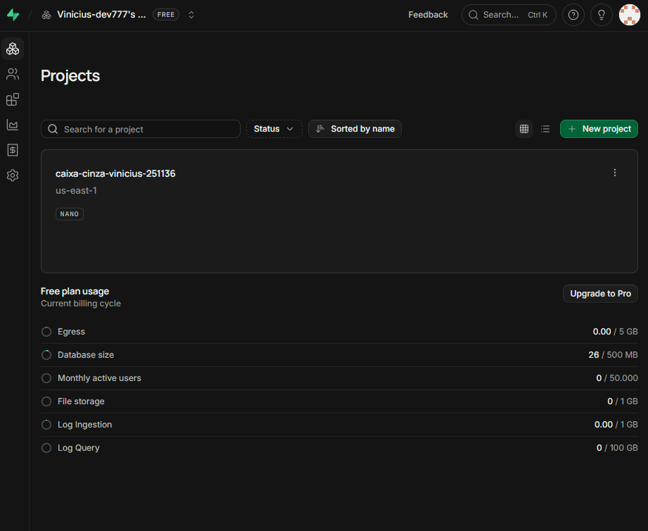 |
| Painel do Supabase | 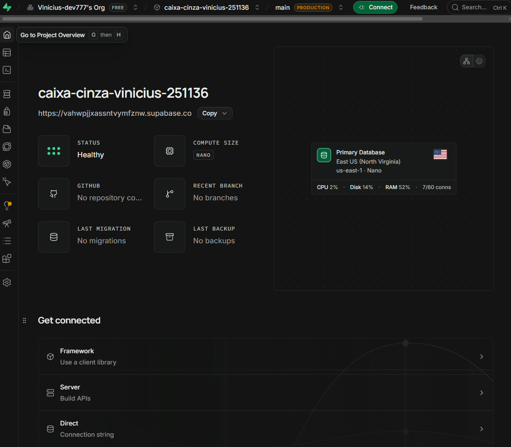 |
| Autenticação habilitada | 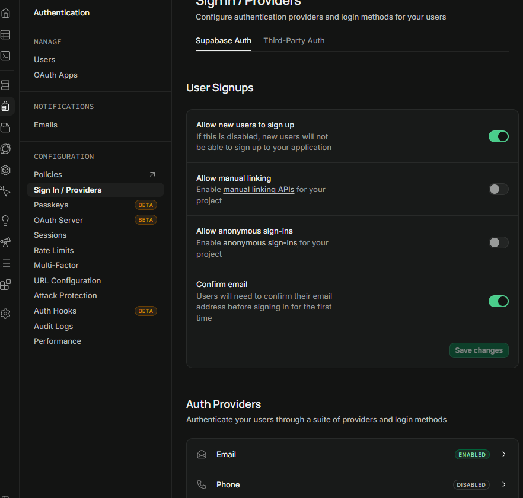 |
| Usuário criado | 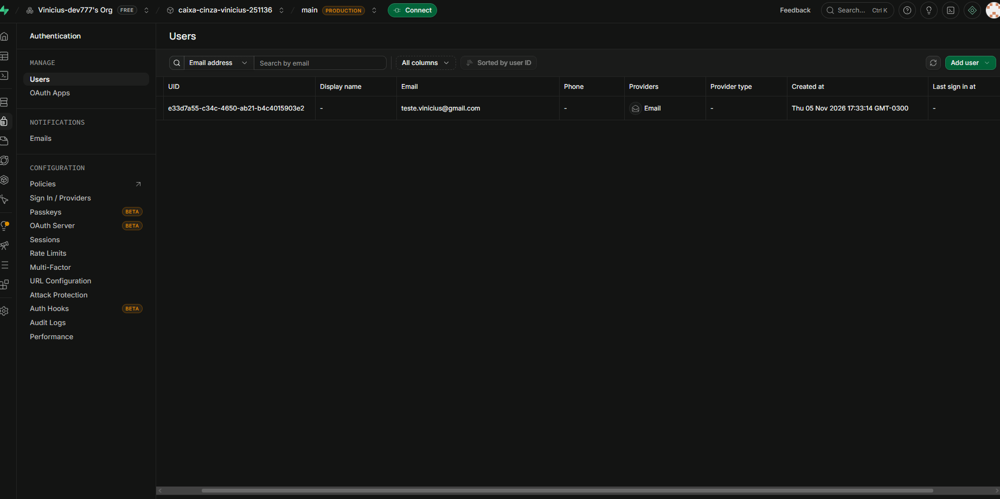 |
| Credenciais da API (chave mascarada) | 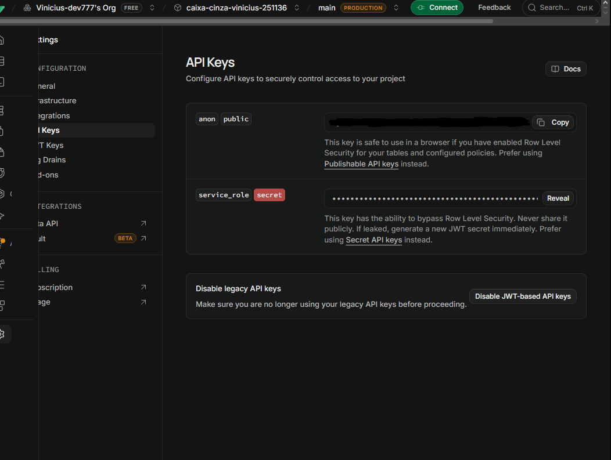 |
| Identificação do aluno no ambiente | 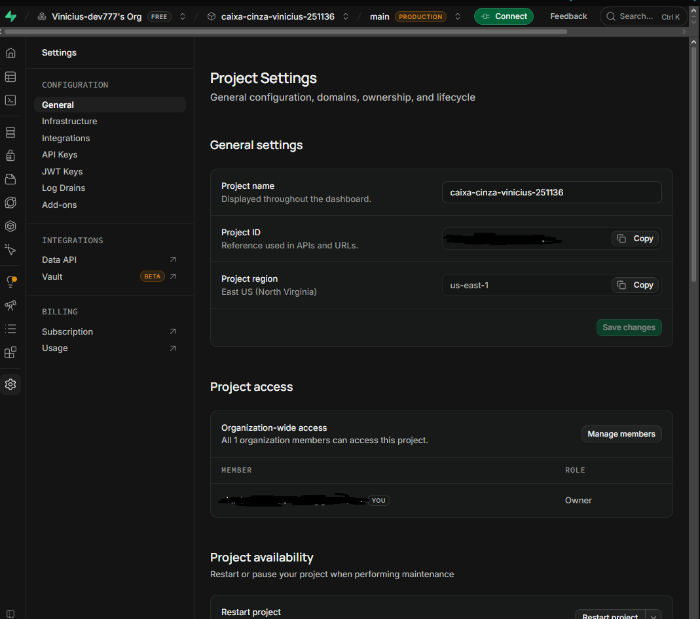 |

# Configuração do Postman

**Workspace:** "Caixa Cinza - Vinicius 251136", criado pelo menu *Workspaces → Create Workspace*.

**Environment:** "Supabase Caixa Cinza", criado na aba *Environments*.

Variáveis configuradas:

| Variável | Descrição | Valor no README |
|---|---|---|
| `base_url` | URL da API do projeto Supabase (não é o link do painel) | `https://<ID-DO-PROJETO>.supabase.co` |
| `api_key` | Chave de API do projeto | `XXXXX` |
| `email` | E-mail do usuário criado para testes | `usuario@email.com` |
| `password` | Senha do usuário de teste | `******` |
| `access_token` | Preenchida automaticamente pelo script do login válido | — |

**Finalidade das variáveis:** evitar repetir dados em cada requisição e permitir trocar de ambiente ou credenciais sem editar cada teste.

**Como o Postman é utilizado:** as requisições ficam organizadas em uma *Collection* ("Supabase Auth - Caixa Cinza"). Cada cenário é uma requisição própria, com um *script de teste* que valida automaticamente o status e o corpo da resposta.

**Evidências:**

| Evidência | Print |
|---|---|
| Workspace criado | 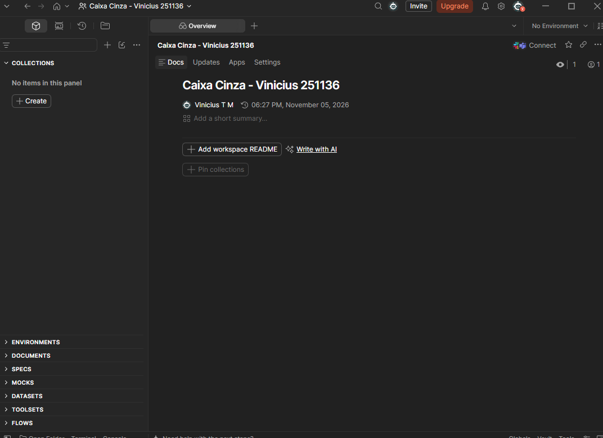 |
| Environment criado e variáveis configuradas |  |
| Organização da collection | 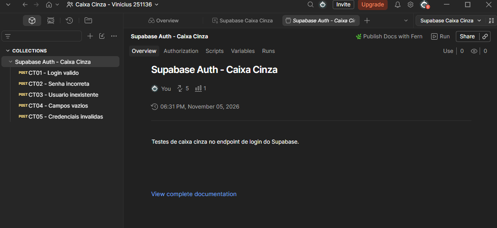 |

> Observação sobre o print 08: nele a `base_url` aparece com o link do painel do Supabase. Essa foi a configuração inicial, que causou o erro **405 Method Not Allowed**. Depois ela foi corrigida para a URL da API (`https://<ID-DO-PROJETO>.supabase.co`), e as requisições passaram a funcionar.

# Configuração das Requisições

- **Endpoint:** `{{base_url}}/auth/v1/token?grant_type=password`
- **Método HTTP:** `POST`
- **Finalidade:** autenticar um usuário por e-mail e senha. Em caso de sucesso, a API retorna `access_token`, `refresh_token` e dados do usuário.

**Headers:**

| Header | Valor |
|---|---|
| `apikey` | `{{api_key}}` |
| `Authorization` | `Bearer {{api_key}}` |
| `Content-Type` | `application/json` |

**Body (raw / JSON):**

```json
{
  "email": "{{email}}",
  "password": "{{password}}"
}
```

No CT04 (campos vazios), o body é `{"email": "", "password": ""}`.

**Evidências:**

| Evidência | Print |
|---|---|
| Endpoint configurado | 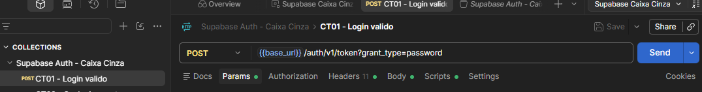 |
| Headers | 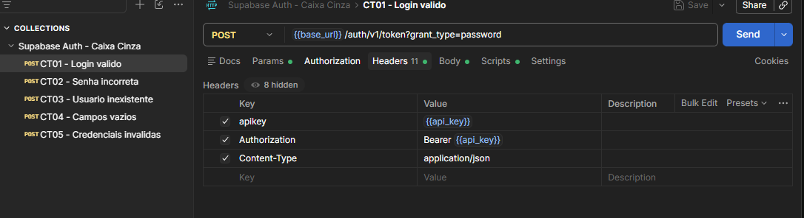 |
| Body JSON | 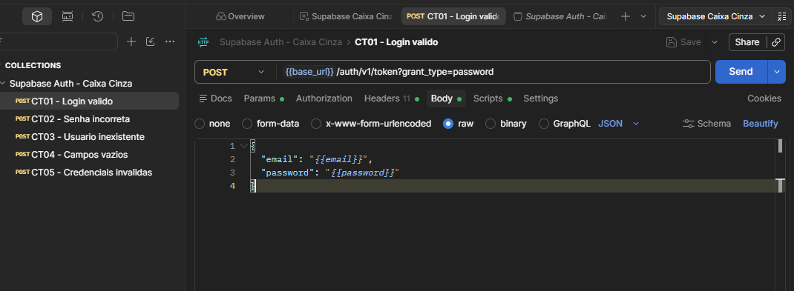 |
| Requisição criada no Postman | 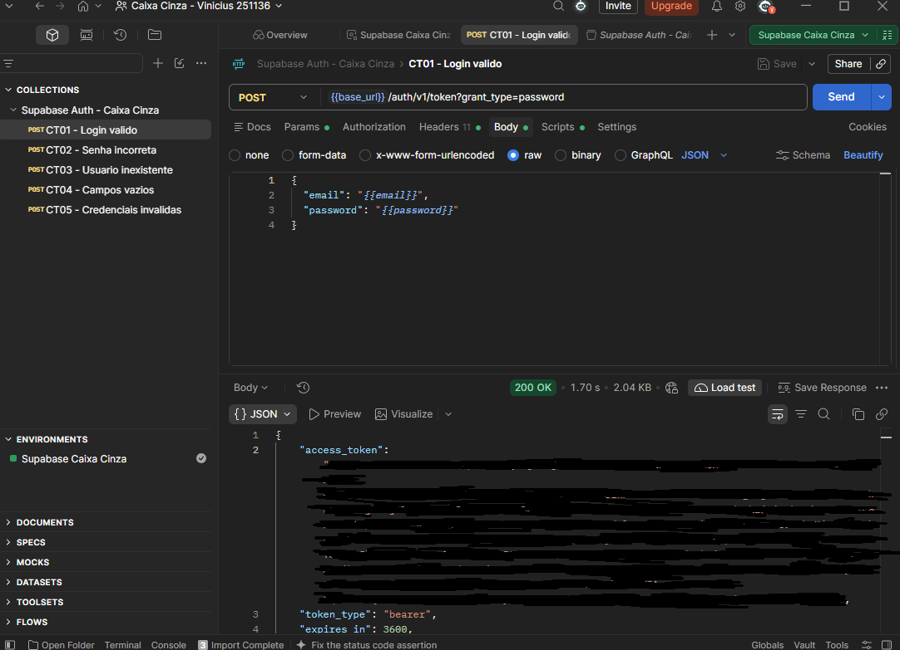 |

A collection exportada (v2.1) e o modelo de environment, com os valores vazios, estão em [`/postman`](postman/).

# Execução dos Testes

Foram executados os 5 cenários obrigatórios. Cada um é uma requisição da collection **Supabase Auth - Caixa Cinza**.

| Cenário | Entrada Utilizada | Resultado Esperado | Resultado Obtido | Status |
|---|---|---|---|---|
| CT01 - Login válido | E-mail e senha corretos | Status 200 + `access_token` | 200 OK com `access_token` | OK |
| CT02 - Senha incorreta | E-mail correto, senha errada | Erro de autenticação (400) | 400, `invalid_credentials`, "Invalid login credentials" | OK |
| CT03 - Usuário inexistente | E-mail não cadastrado | Acesso negado (400) | 400, `invalid_credentials`, "Invalid login credentials" | OK |
| CT04 - Campos vazios | `email` e `password` vazios | Erro de validação | 400, `validation_failed`, "missing email or phone" | OK |
| CT05 - Credenciais inválidas | E-mail e senha inválidos | Mensagem de erro | 400, `invalid_credentials`, "Invalid login credentials" | OK |

**Cenários executados e entradas:**

- **CT01:** e-mail e senha corretos do usuário de teste, vindos das variáveis do environment.
- **CT02:** e-mail correto com uma senha errada.
- **CT03:** e-mail que não existe no cadastro, com uma senha qualquer.
- **CT04:** `email` e `password` enviados como texto vazio.
- **CT05:** e-mail e senha inválidos, que não correspondem a nenhum usuário.

**Resultados obtidos:** o CT01 retornou 200 OK com o `access_token`. Os demais cenários retornaram erro 400. O CT02, o CT03 e o CT05 devolveram a mesma resposta (`invalid_credentials`, "Invalid login credentials"), o que impede descobrir se um e-mail existe ou não no sistema, evitando a enumeração de usuários. O CT04 retornou uma resposta de validação específica (`validation_failed`, "missing email or phone"), e não uma mensagem genérica.

**Erros encontrados (dificuldades reais):**

- Achar a API Key no painel novo do Supabase, que mostra a chave *publishable* e deixa a *anon* na aba *Legacy*.
- Erro **405 Method Not Allowed**, causado por usar na `base_url` o link do painel do Supabase em vez da URL da API.
- O body da requisição sumiu ao trocar o tipo para JSON.

**Evidências:**

| Evidência | Print |
|---|---|
| CT01 - Login válido (status 200 + token mascarado) | 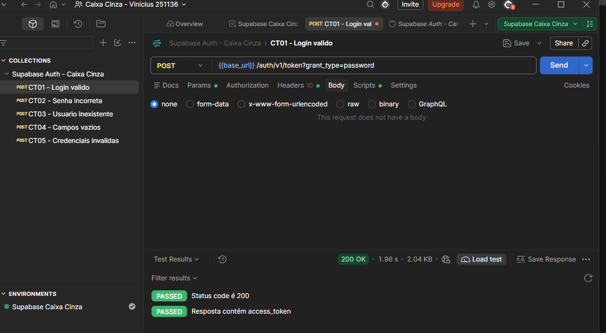 |
| CT02 - Senha incorreta | 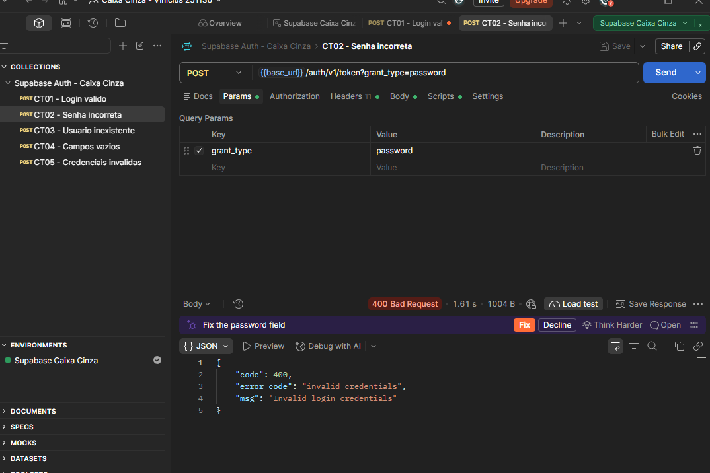 |
| CT03 - Usuário inexistente | 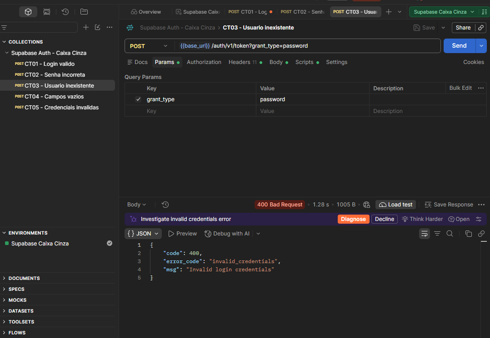 |
| CT04 - Campos vazios | 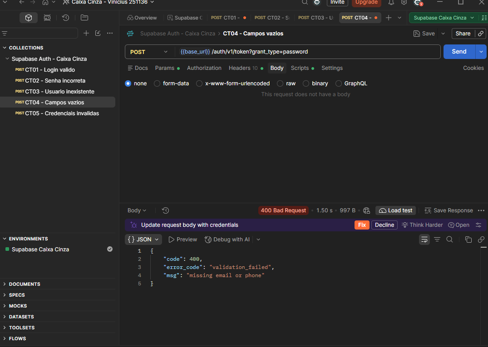 |
| CT05 - Credenciais inválidas | 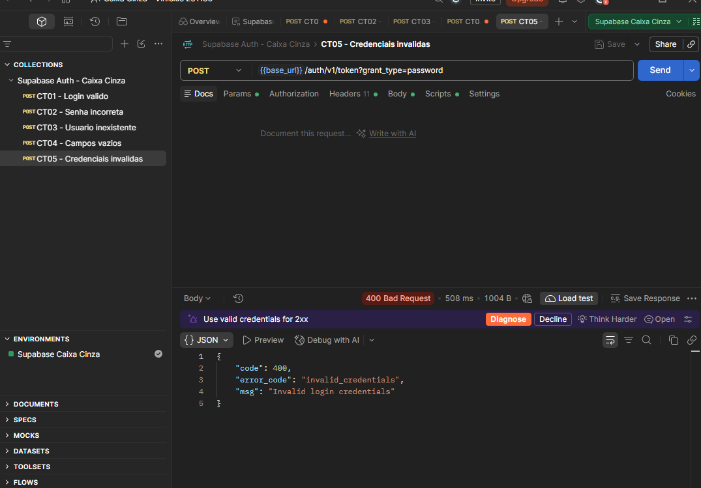 |
| Resultado da execução completa (Collection Runner) | 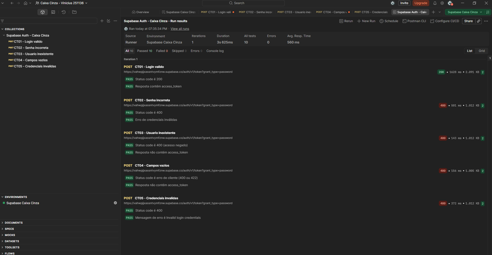 |

# Registro dos Testes

Os testes foram registrados na planilha [`planilha/PLANO_DE_TESTE_CAIXA_CINZA.xlsx`](planilha/PLANO_DE_TESTE_CAIXA_CINZA.xlsx), com as abas **INFORMATIVO** e **REGISTRO DE TESTES**. Os campos são: ID do teste, cenário, entrada, resultado esperado, resultado obtido, status e observações.

**Como os testes foram registrados:** depois de executar cada requisição no Postman, o status HTTP e a mensagem retornada foram anotados na aba REGISTRO DE TESTES, junto com o status do teste e uma observação.

**Falhas identificadas:** nenhum cenário falhou. As falhas encontradas foram de configuração, e não de comportamento da API: a base_url com o link do painel (erro 405) e o body que sumiu ao trocar o tipo para JSON.

| Evidência | Print |
|---|---|
| Planilha preenchida | 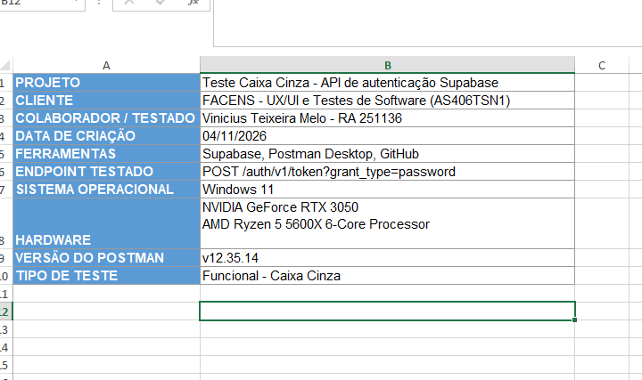 |
| Exemplos de registros | 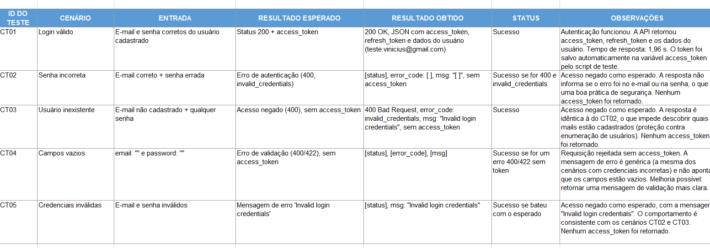 |

# Resultados Obtidos

No **Collection Runner**, a execução completa teve **10 testes, 10 aprovados e 0 falhas**. São 5 requisições com 2 verificações cada, e todas passaram.

| Total de cenários | Aprovados | Reprovados |
|---|---|---|
| 5 | 5 | 0 |

# Importância da documentação dos testes

Escreva aqui com as suas palavras.

# Conclusão

Escreva aqui com as suas palavras, comentando:

- Os testes foram executados corretamente?
- A autenticação funcionou?
- Quais dificuldades encontrou?
- Quais falhas foram identificadas?
- Quais melhorias poderiam ser implementadas?
- Qual a importância dos testes caixa cinza em APIs?
